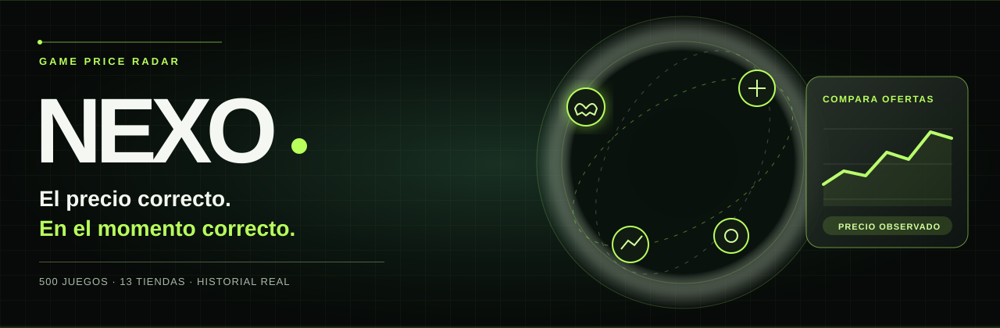
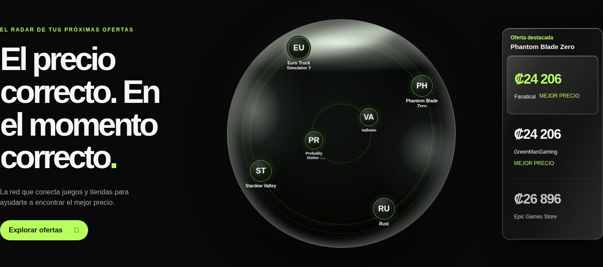
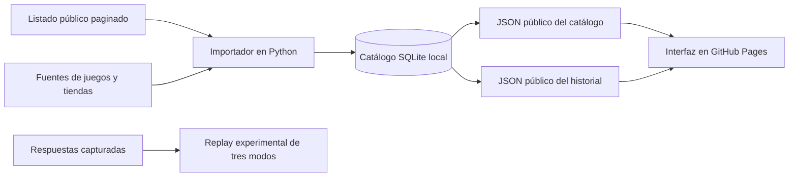

# NEXO

[English](README.md) | **Español**



**NEXO ayuda a descubrir juegos, comparar ofertas de PC y consultar el historial de precios observados.** Es un proyecto académico con una interfaz adaptable y un catálogo alimentado por una base SQLite local. La [demostración pública](https://greivinsmv.github.io/NEXO/) funciona en GitHub Pages.

La captura pública actual contiene **500 juegos**, ofertas de **13 tiendas** y al menos **dos tiendas de PC por juego**. Las plataformas de cada ficha indican dónde se lanzó el juego; no significan que NEXO tenga precios de consola.

## Funciones


- **Explora:** busca entre 500 juegos; filtra por género, plataforma de lanzamiento, precio o tienda; ordena por relevancia, popularidad, valoración, descuento o precio.
- **Elige la vista:** alterna entre tarjetas y lista compacta, con páginas de 10, 20 o 30 juegos.
- **Compara ofertas de PC:** consulta las tiendas disponibles, el precio observado, la fecha de captura y el enlace a cada tienda.
- **Conoce cada juego:** revisa capturas, logros, valoraciones y tiempo estimado para completarlo cuando existen esos datos.
- **Consulta el historial real:** compara observaciones fechadas por tienda sin inventar tendencias entre capturas faltantes.
- **Previsualiza las imágenes:** pasa el cursor sobre una portada o mantenla presionada en el móvil para recorrer sus capturas.

### Interfaz en funcionamiento



## Flujo de datos



SQLite es la base de trabajo. La web estática lee JSON generados desde ella y no necesita un servidor de base de datos para los visitantes. Un motor experimental compara ejecución secuencial, E/S concurrente y emparejamiento por procesos con respuestas capturadas; el [informe de desarrollo](docs/experimento-replay-desarrollo.md) distingue los resultados medidos de sus límites.

## Tecnologías

| Componente | Tecnologías |
| --- | --- |
| Interfaz | HTML, CSS y JavaScript sin framework |
| Catálogo | Python, SQLite y JSON generado |
| Experimento de captura | Hilos, procesos, colas acotadas y replay |
| Verificación | `unittest` de Python y pruebas de interfaz en Chromium con Playwright |
| Alojamiento | GitHub Pages |

## Estructura del repositorio

```text
index.html, game.html   Catálogo público y fichas de juegos
*.css, *.js             Interfaz, filtros, galería y gráficas
data/                  JSON públicos que consume la web
scripts/               Importadores, motor de emparejamiento y pruebas
docs/                  Decisiones técnicas y mediciones
assets/                Imágenes del README y vista de la interfaz
```

## Cómo ejecutarlo

Clona o descarga este repositorio. Desde su raíz, ejecuta:

```sh
python -m http.server 8765
```

Abre `http://localhost:8765/`. Los JSON incluidos bastan para explorar la web; no hace falta instalar SQLite para verla. Para ejecutar las pruebas de Python:

```sh
python -m unittest discover -s scripts -p 'test_*.py'
```

## Datos, privacidad y alcance

Este repositorio público contiene el código y los datos de juegos y ofertas necesarios para la web. Excluye la base SQLite de trabajo, las capturas originales, cachés y credenciales. Antes de publicar cambios, ejecuta `python scripts/check_public_snapshot.py`.

Los precios mostrados son de **PC**. PlayStation, Xbox y Switch indican plataformas de lanzamiento; las fichas y los precios de sus tiendas todavía no están verificados. Las estimaciones de duración son históricas y los valores faltantes se muestran como no disponibles. Las notas del [catálogo](docs/catalogo.md) y del [motor multicore](docs/motor-multicore.md) documentan la procedencia y lo que permanece experimental.
