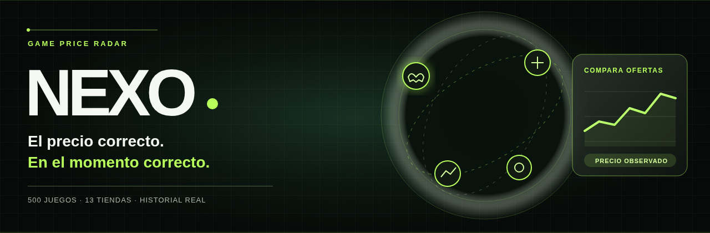
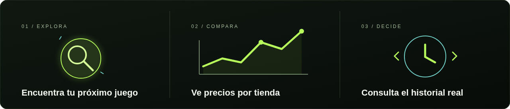
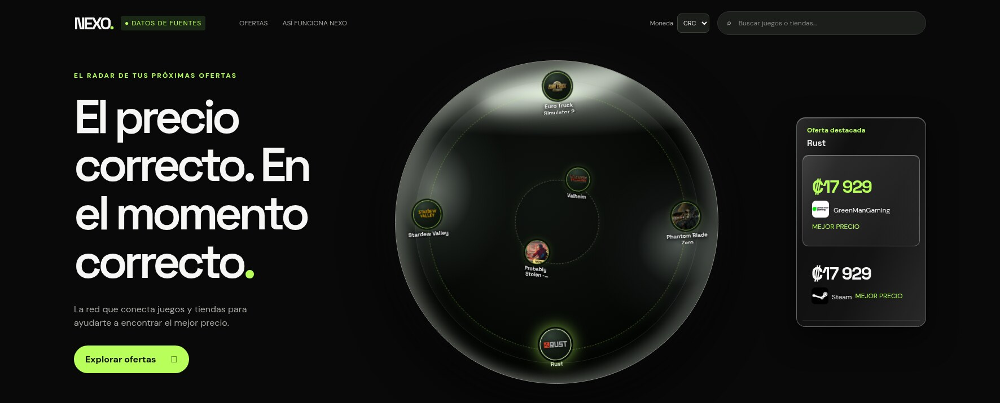
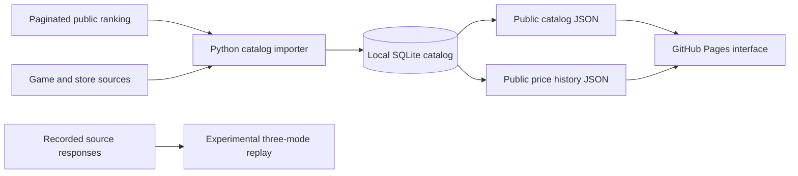

# NEXO

**English** | [Español](README.es.md)



**NEXO helps players discover games, compare PC offers and inspect observed price history.** It is an academic project built as a responsive catalog backed by a local SQLite data pipeline. The [live demo](https://greivinsmv.github.io/NEXO/) runs on GitHub Pages.

The current public snapshot contains **500 games**, offers from **13 stores**, and at least **two PC stores per game**. Platform labels describe where a game was released; they do not imply that NEXO has console prices.

## Features



- **Discover:** search 500 games; filter by genre, release platform, price or store; sort by relevance, popularity, user rating, discount or price.
- **Choose your view:** switch between cards and a compact list, with pages of 10, 20 or 30 games.
- **Compare PC offers:** see each available store, its observed price, capture date and a link to the store.
- **Inspect each game:** browse screenshots, achievements, user ratings, critic ratings and estimated playtime when available.
- **Follow real history:** compare dated price observations by store without inventing trends between missing captures.
- **Preview media:** hover over a catalog cover or hold it on mobile to cycle through screenshots.

### Live interface



## Data flow



SQLite is the working catalog. The static site reads generated JSON, so visitors do not need a database server. An experimental pipeline compares sequential execution, concurrent I/O and process-based matching using recorded responses; the [development report](docs/experimento-replay-desarrollo.md) states its measurements and limits.

## Technology

| Component | Technologies |
| --- | --- |
| Interface | HTML, CSS and vanilla JavaScript |
| Catalog | Python, SQLite and generated JSON |
| Collection experiment | Threading, multiprocessing, bounded queues and replay fixtures |
| Verification | Python `unittest` and Chromium interface checks with Playwright |
| Hosting | GitHub Pages |

## Repository structure

```text
index.html, game.html   Public catalog and game pages
*.css, *.js             Interface, filters, gallery and charts
data/                  Public JSON consumed by the site
scripts/               Importers, matching engine and tests
docs/                  Architecture decisions and measured results
assets/                README graphics and interface preview
```

## Getting started

Clone or download this repository. From its root, run:

```sh
python -m http.server 8765
```

Open `http://localhost:8765/`. The included JSON is enough to explore the site; SQLite is not required for viewing it. To run the Python tests:

```sh
python -m unittest discover -s scripts -p 'test_*.py'
```

## Data, privacy and scope

This public repository contains source code and the game and offer data needed by the site. It excludes the working SQLite database, raw source captures, caches and credentials. Run `python scripts/check_public_snapshot.py` before publishing an update.

Prices shown in NEXO are for **PC**. PlayStation, Xbox and Switch labels are release information; console store listings and prices have not been verified. Playtime estimates are historical and missing values are shown as unavailable. The [catalog notes](docs/catalogo.md) and [multicore engine notes](docs/motor-multicore.md) document provenance and work that remains experimental.
