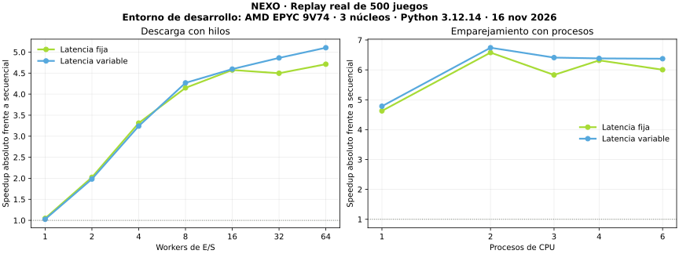

# Ensayo de replay con datos reales · 16 de noviembre de 2026

Este ensayo mide el pipeline con respuestas reales de **Steam Store y CheapShark** para los 500 juegos publicados. No sustituye el experimento final del equipo: aún faltan las demás fuentes obligatorias, la revisión manual del emparejamiento y las mediciones en la máquina de entrega.

## Datos y equipo

- 500 juegos, 1.740 trabajos: 500 respuestas de Steam Store y 1.240 trabajos sobre páginas paginadas de CheapShark. Se guardaron 564 archivos con SHA-256: 500 de Steam, 62 páginas de CheapShark y 2 páginas de SteamSpy para la etapa 0. Las páginas de la etapa 0 están capturadas, pero aún no pasan por el mismo pipeline.
- Las respuestas de CheapShark se conservan como bytes originales. Las de Steam proceden de la caché reciente del importador, que decodifica y vuelve a serializar el JSON. Cada archivo conserva su fecha de observación en `data/replay/metadata.json`.
- Entorno de desarrollo: Linux 6.18.57, AMD EPYC 9V74, 3 núcleos disponibles, 10,2 GB de memoria, Python 3.12.14. No representa necesariamente el equipo del grupo.
- Cinco repeticiones por configuración, cola de 32 trabajos, 8 hilos de E/S fijos para el barrido de CPU. Se midió latencia fija de 10 ms y latencia de 10 ms más una variación determinista de 0 a 2 ms por archivo. Hilos de E/S: 1, 2, 4, 8, 16, 32 y 64; procesos de CPU: 1, 2, 3, 4 y 6.

Los tres modos devolvieron los mismos 1.740 resultados en todas las configuraciones y repeticiones, con **cero fallos**. El SHA-256 de la salida ordenada es `de790754f69026074745e50732954410efcd6e3de9904e07a010d17b9bd24d63`. Hubo 232 decisiones marcadas como dudosas; ese conteo no mide precisión ni exhaustividad sin pares revisados manualmente.

## Tiempos principales

| Modo | Workers | Mediana fija | Mediana variable | Speedup fijo | Speedup variable |
| --- | ---: | ---: | ---: | ---: | ---: |
| Secuencial | 1 | 22,63 s | 24,09 s | 1,00× | 1,00× |
| Concurrente | 8 hilos | 5,45 s | 5,64 s | 4,15× | 4,27× |
| Concurrente | 32 hilos | 5,03 s | 4,96 s | 4,50× | 4,86× |
| Paralelo completo | 8 hilos + 2 procesos | 3,44 s | 3,57 s | 6,58× | 6,74× |



Con 8 hilos se solapa gran parte de la espera simulada. Pasar de 8 a 32 hilos mejora poco en relación con el número de workers; 64 reduce la mediana variable de 4,96 a 4,72 s, una mejora pequeña para duplicar los hilos. Con 8 hilos y 2 procesos, el emparejamiento reduce la mediana frente a un solo proceso; en esta máquina de 3 núcleos, usar 3 o más procesos no mejoró la mediana. Estas observaciones corresponden a esta carga y este entorno, no a una garantía de rendimiento general.

El listado ampliado de CPU, construido con 499 candidatos únicos de las capturas reales, también entregó resultados idénticos entre los tres modos. En una pasada diagnóstica sin latencia simulada tardó 21,41 s secuencial y 16,10 s con 2 procesos. Esa pasada no tiene cinco repeticiones y se conserva solo como comprobación de que la etapa de cálculo tiene trabajo medible.

## Reproducción y límites

```bash
python scripts/capture_replay.py
python scripts/build_replay_pool.py
python scripts/benchmark_pipeline.py --manifest data/replay/manifest.json \
  --fixture-root data/replay --output resultados/replay-fijo.csv \
  --repetitions 5 --latency-ms 10 --jitter-ms 0
python scripts/benchmark_pipeline.py --manifest data/replay/manifest.json \
  --fixture-root data/replay --output resultados/replay-variable.csv \
  --repetitions 5 --latency-ms 10 --jitter-ms 2
```

Los CSV completos están en [latencia fija](data/replay-fixed-development.csv) y [latencia variable](data/replay-variable-development.csv). Incluyen mediana, mínimo, máximo, tiempos por etapa, speedup absoluto y relativo, eficiencia y Karp–Flatt. Las respuestas originales quedan en `data/replay/` y no se suben a Git; ejecutar la captura para reproducir el corpus. Para la entrega final hay que repetir el experimento con todas las fuentes y el hardware del grupo, documentar la validación de 60 pares y responder las preguntas del informe con esos resultados.
